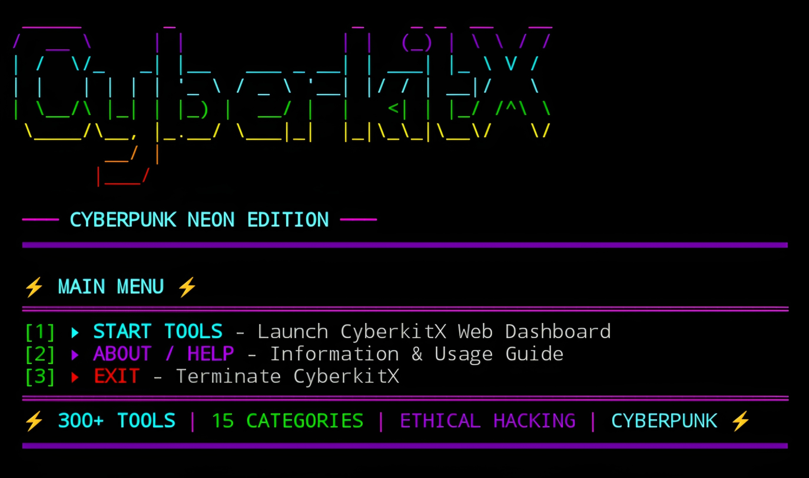

# CYBERKITX


<p align="center">
  <strong>300+ Tools – 15 Categories – Cyberpunk Neon Edition</strong><br>
  <em>"Ethical hacking suite, wrapped in neon." – Mr.X</em>
</p>

## Introduction
CYBERKITX is a powerful all-in-one cybersecurity and ethical hacking toolkit featuring over 300 tools across 15 categories. With a stunning cyberpunk neon interface, it provides capabilities for information gathering, network scanning, web analysis, exploitation, social engineering, and much more—all accessible via an intuitive web dashboard. Built with Python, CYBERKITX runs smoothly on **Termux (Android)**, Linux, Windows, and Kali Linux—**no root required**.

## Installation
```bash
$ pkg update -y && pkg upgrade -y
$ pkg install git python -y
$ git clone https://github.com/Whomrx666/Cyberkitx.git
$ cd Cyberkitx
$ python3 install.py
```

## Run manually
```
$ python3 cyberkitx.py
```

## Features
- **300+ Security Tools** – Comprehensive suite for ethical hacking.
- **15 Categories** – Info Gathering, Network Scanning, Web Analysis, Crypto & Encoding, Utilities, Forensic, Email & OSINT, Text Tools, Cloud Security, Miscellaneous, Exploitation, Wireless & Radio, Social Engineering, Stresser, Web Security.
- **Web Dashboard** – Intuitive HTML interface for tool selection and execution.
- **Live Attack Status** – Monitor packet counts, elapsed time, and logs for stresser tools.
- **File Upload Support** – Upload files for forensic analysis and processing.
- **Real-time Output** – Immediate results displayed in the dashboard.
- **Cyberpunk UI** – Neon colors, live tables, progress bars, and smooth animations.
- **Termux Optimized** – Works flawlessly on Android without root.
- **No API Keys Required** – All tools function with built-in fallback mechanisms.
- **Graceful Fallbacks** – Tools work even when optional dependencies are missing.

## Menu Options
| #  | Option | Description |
|----|--------|-------------|
| 1  | Start Tools | Launch CyberkitX Web Dashboard |
| 2  | About / Help | Information & Usage Guide |
| 3  | Exit | Terminate CyberkitX |

## Instructions
1. **Install** the tool using the commands above.
2. **Run** `python3 cyberkitx.py` after installation.
3. **Navigate** the main menu by typing the option number and pressing Enter.
4. **In the web dashboard**:
   - Click any tool button to select it.
   - Enter target (IP/domain/hash/URL) in the input field.
   - Click ` EXECUTE` to run the tool.
   - For stresser tools, click ` STOP ATTACK` to halt the attack.
   - Use the `COPY` button to copy output to clipboard.
   - Upload files for forensic tools using the file input.
5. **Keyboard shortcuts**:
   - `Ctrl+C` anywhere to safely exit the program.
   - `Enter` to confirm selections.
   - `p` / `n` to navigate pages in live monitors (if applicable).

## Observation
This tool is intended for **educational and informational purposes only**. CYBERKITX is designed for ethical hacking, security research, and penetration testing. Always obtain proper authorization before testing any system. The author assumes no responsibility for any misuse or damage caused by this tool.

### Original Author
<a href="https://github.com/Whomrx666"></a>

### <<< If you copy, then give me the credits >>>

## CONNECT WITH ME :

[](https://whomrx.pages.dev)
[](https://whomrxhackers.blogspot.com)
[](https://twitter.com/whomrx666)
[](https://wa.me/6285926601133?text=Halo%2C%20Mr.X)
[](https://www.facebook.com/whomrx.666)
[](https://t.me/Whomr_X)
[](mailto:whomrx666@gmail.com)
[](https://www.tiktok.com/@whomr.x)

**If you want to donate, click on the button**
<a href="https://saweria.co/whomrx"></a>

---

<p align="left">
  
</p>